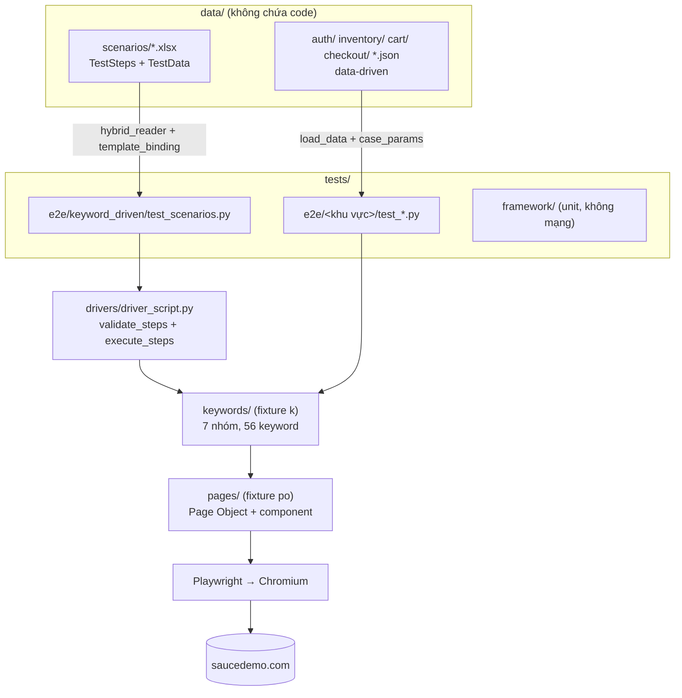
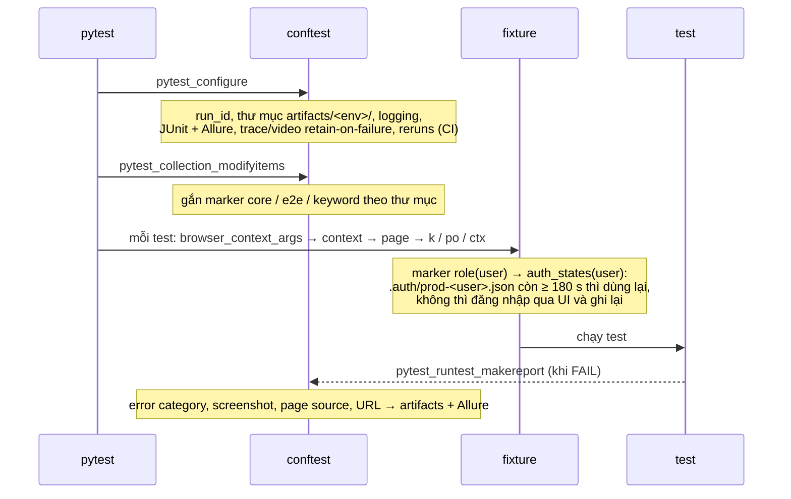

# Kiến trúc dự án saucedemo-e2e

Tài liệu mô tả **cấu trúc bên trong** của framework: các tầng, cách chúng phụ thuộc nhau, vòng đời một test
và cơ chế xử lý lỗi. Cách cài đặt, lệnh chạy và cách viết test xem [README.md](README.md).
Kết quả khảo sát trang thật (data-test, URL, thông báo nguyên văn, cookie, localStorage) xem
[docs/site-survey.md](docs/site-survey.md).

## 1. Tổng quan

- **Đối tượng kiểm thử**: https://www.saucedemo.com (Swag Labs) — SPA thuần frontend, không có backend API,
  không có trang quản trị. Phiên đăng nhập là cookie `session-username` (hết hạn sau 600 s);
  giỏ hàng là localStorage `cart-contents` (mảng id sản phẩm).
- **Công nghệ**: Python 3.11+, pytest, pytest-playwright (chỉ Chromium), pytest-xdist (song song),
  pytest-rerunfailures (retry trên CI), allure-pytest, openpyxl (đọc kịch bản Excel).
- **Mô hình**: Hybrid = **POM** + **Keyword-Driven** + **Data-Driven**.



## 2. Các tầng và trách nhiệm

| Tầng | Thư mục | Trách nhiệm | Được gọi bởi |
|---|---|---|---|
| Cấu hình | [config.py](config.py) | Đọc `.env`; URL, mật khẩu chung, danh sách user, timeout, viewport | Mọi tầng |
| Data | [data/](data/) | Test case, input, expected, kịch bản Excel | `utils/` (loader) |
| Test | [tests/](tests/) | Chọn dữ liệu, gọi keyword | pytest |
| Driver Script | [drivers/](drivers/) | Kiểm tra schema kịch bản, thay biến runtime, chạy từng bước, gắn ngữ cảnh vào lỗi | `tests/e2e/keyword_driven` |
| Keyword | [keywords/](keywords/) | Bước nghiệp vụ + kiểm tra; mỗi keyword = 1 Allure step + log START/PASS/FAIL | Test, Driver |
| Page Object | [pages/](pages/) | Locator và thao tác nguyên tử; không assertion nghiệp vụ | Keyword (và conftest khi tạo phiên) |
| Utils | [utils/](utils/) | Logging, phân loại lỗi, evidence, đọc dữ liệu, storage, thông báo nguyên văn | Mọi tầng |

**Quy tắc phụ thuộc** (chỉ đi một chiều): `tests → drivers → keywords → pages → Playwright`.
Page Object không biết đến keyword; keyword không mở/đóng browser; **locator chỉ nằm trong `pages/`**.

## 3. Chi tiết từng tầng

### 3.1 Page Object — `pages/`

```text
pages/
  base_page.py              # BasePage (title, error dùng chung) + slug(tên sản phẩm)
  page_objects.py           # PageObjects: gom mọi page/component của 1 `page` (k.po.inventory, k.po.menu...)
  components/header.py      # icon giỏ + badge
  components/burger_menu.py # nút mở/đóng, 5 mục menu, panel (trạng thái mở)
  login_page.py  inventory_page.py  product_detail_page.py  cart_page.py
  checkout_info_page.py  checkout_overview_page.py  checkout_complete_page.py
```

- `selectors.set_test_id_attribute("data-test")` (fixture `_test_id_attribute`) → mọi locator ưu tiên
  `get_by_test_id(...)`; `get_by_role` chỉ dùng khi không có `data-test` (2 nút burger, panel menu).
- `data-test` trùng giữa các item (`inventory-item-name`...) → lọc theo item cha bằng `filter(has=...)`;
  nút thêm/bỏ dùng `data-test` có slug: `add-to-cart-<slug>` / `remove-<slug>`.
- Menu đóng chỉ bị dịch ra ngoài màn hình (`is_visible()` vẫn `True`) nhưng có `aria-hidden="true"` →
  trạng thái mở xác định bằng `get_by_role("navigation")` (role locator bỏ qua phần tử aria-hidden).

### 3.2 Keyword — `keywords/`

- [base_keywords.py](keywords/base_keywords.py): `BaseKeywords(page, po)` + decorator `@keyword("tenCamelCase")`.
  `self.step(title)` bọc thân keyword: tạo Allure step, che mật khẩu (`mask_secrets`), log kèm error category.
- [keywords/\_\_init\_\_.py](keywords/__init__.py):
  - `GROUPS` liệt kê 7 nhóm: `common, auth, inventory, product, cart, checkout, menu`.
  - `KEYWORD_MAP` — registry tường minh `"nhóm.tenKeyword" → (thuộc tính, method)`, dựng lúc import,
    báo lỗi nếu trùng tên hoặc nhóm thiếu `group`. Không dùng `eval`.
  - `Keywords` (fixture `k`): tạo `PageObjects` rồi từng nhóm; `resolve(name)` trả method đã bind.
- Keyword hành động (`addProductToCart`, `finishCheckout`...) chỉ thao tác; kết quả được kiểm tra bằng
  keyword `verify*` / `…Expecting…` riêng → lỗi cố ý của app lộ ra đúng ở bước kiểm tra.
- Danh mục đầy đủ sinh tự động vào [KEYWORDS.md](KEYWORDS.md) bằng `scripts/gen_keywords_doc.py`.

### 3.3 Driver Script — `drivers/driver_script.py`

1. `validate_steps`: đúng schema (`case_id, step, keyword, args, note`), step liên tục 1..n,
   keyword có trong `KEYWORD_MAP`, `args` là mảng, có ít nhất 1 bước kiểm tra (`verify*` / `…Expecting…`).
2. `execute_steps`: với mỗi bước — `resolve_data(args, ctx)` thay `${...}` → log START → gọi keyword trong Allure step.
3. Lỗi: phân loại, `add_note` (case, step, keyword, args, category), log, đính kèm category vào Allure, rồi **raise lại**.

### 3.4 Data — `data/` và `utils/`

| Nguồn | Đường đi |
|---|---|
| `data/<khu-vực>/*.json` | `load_data` → `case_params` → `@pytest.mark.parametrize("case", ...)` |
| `data/scenarios/*.xlsx` | `hybrid_reader` (sheet `TestSteps` + `TestData`) → `template_binding` (gắn `{cot}`) → 1 pytest item / dòng TestData |

File `.xlsx` sinh bằng `scripts/gen_scenarios_xlsx.py` (định nghĩa kịch bản nằm trong script → tái tạo được).

Hai tầng thay biến:

| Cú pháp | Thời điểm | Xử lý ở |
|---|---|---|
| `{cot}` | Collection — lỗi báo trước khi mở browser | `utils/template_binding.py` |
| `${msg.login.lockedOut}`, `${env.password}`, `${uid}` | Runtime | `utils/data_loader.resolve_data` + fixture `ctx` |
| `"@data:inventory/sorting.json#za.names"` | Khi thay biến | `utils/data_loader.py` |

Thông báo mong đợi lấy **nguyên văn** từ trang thật, đặt tại [utils/messages.py](utils/messages.py);
dữ liệu tham chiếu bằng `${msg...}` nên không lặp chuỗi.

Metadata của case ([utils/cases.py](utils/cases.py)):

| Meta | Tác dụng |
|---|---|
| `tags` | marker, vd `@smoke` → `pytest.mark.smoke` |
| `requires` | skip khi thiếu điều kiện (`password` = cần `SAUCE_PASSWORD`) |
| `knownBug` | `xfail(strict=True)` — lỗi cố ý của problem_user / error_user / visual_user; nếu PASS → báo "bug đã sửa?" |
| `session` | marker `role(user)` → test chạy với phiên đăng nhập sẵn của user đó |

### 3.5 Utils — `utils/`

| File | Vai trò |
|---|---|
| `logging_config.py` | Log có cấu trúc `TC_ID \| Step \| Action \| Target \| Result`; `current_tc_id` (contextvar) |
| `error_classifier.py` | Taxonomy lỗi dùng chung cho log / JUnit / Allure |
| `artifact_manager.py` | Thư mục evidence theo `run_id`, tên file an toàn |
| `hybrid_reader.py`, `template_binding.py` | Đọc và binding kịch bản Excel |
| `data_loader.py`, `cases.py` | Nạp JSON, thay biến, che bí mật, metadata case |
| `storage.py` | Ghi storageState (atomic), đọc hạn cookie phiên, đọc giỏ trong localStorage |
| `assertions.py` | `poll_until` (chờ bằng `page.wait_for_timeout`), `money` (Decimal) |
| `routes.py`, `messages.py` | Đường dẫn trang, thông báo nguyên văn của app |

## 4. Vòng đời một lần chạy — `tests/conftest.py`



Fixture chính:

| Fixture | Scope | Nội dung |
|---|---|---|
| `_test_id_attribute` | session | `selectors.set_test_id_attribute("data-test")` |
| `auth_states` | session | Hàm `user → file storageState còn hạn`; đăng nhập qua UI một lần cho mỗi user cần dùng (mỗi worker), tự làm mới khi cookie sắp hết hạn |
| `browser_context_args` | test | `base_url`, locale, viewport; marker `role` chọn phiên đăng nhập |
| `context` / `page` | test | Context mới (timeout mặc định), page mới |
| `k` / `po` | test | Thư viện keyword / Page Object |
| `ctx` | test | Biến runtime cho `${...}`: `env` (URL, mật khẩu), `msg` (thông báo) |

## 5. Lỗi và bằng chứng

- Không keyword nào nuốt lỗi để trả boolean; lỗi luôn đi lên tới pytest. Không dùng `time.sleep`.
- Phân loại: `ASSERTION_FAILED`, `TIMEOUT`, `LOCATOR_AMBIGUOUS`, `NETWORK_ERROR`, `BROWSER_CLOSED`,
  `PLAYWRIGHT_ERROR`, `DATA_OR_CONTRACT_ERROR`, `UNEXPECTED_ERROR`.
- Một đầu mối thu evidence duy nhất (`pytest_runtest_makereport`); pytest-playwright giữ trace + video khi FAIL.
- Bí mật: mật khẩu chỉ ở `.env` / GitHub Secret `SAUCE_PASSWORD`; `mask_secrets` che trong log và tên step.
  Lưu ý: trace Playwright (chỉ giữ khi FAIL) ghi nguyên giá trị `fill`, kể cả mật khẩu.
- Đầu ra:

```text
artifacts/prod/
  logs/  screenshots/<run_id>/  page_sources/<run_id>/  traces/<run_id>/  junit/results.xml  allure-results/
```

## 6. Phân nhóm test

| Thư mục | Marker | Cần mạng? |
|---|---|---|
| `tests/framework/` | `core` | Không — unit test của chính framework |
| `tests/e2e/<khu-vực>/` | `e2e` | Có — smoke, auth, inventory, cart, checkout, menu |
| `tests/e2e/keyword_driven/` | `keyword` + `e2e` | Có — chạy toàn bộ `data/scenarios/*.xlsx` |

Marker theo dữ liệu: `smoke` (từ `tags`).

## 7. CI/CD và tài liệu sinh tự động

- [.github/workflows/e2e.yml](.github/workflows/e2e.yml): chạy khi push/PR vào `main` hoặc chạy tay theo marker.
  Các bước: cài dependency + Chromium → `--collect-only` (bắt lỗi dữ liệu sớm) → `pytest -n 4`
  → bảng tóm tắt từ JUnit → upload `artifacts/prod/`.
- `scripts/gen_keywords_doc.py` → [KEYWORDS.md](KEYWORDS.md); `scripts/gen_test_cases.py` → [TEST_CASES.md](TEST_CASES.md)
  (từ kết quả lần chạy gần nhất); `scripts/gen_scenarios_xlsx.py` → `data/scenarios/*.xlsx`.

## 8. Mở rộng framework

| Muốn | Sửa ở đâu |
|---|---|
| Thêm case cho test có sẵn | Thêm phần tử vào file JSON trong `data/` |
| Kịch bản mới không cần code | Thêm vào `WORKBOOKS` trong `scripts/gen_scenarios_xlsx.py` rồi chạy script |
| Keyword mới | Locator ở `pages/` → method `@keyword` trong `keywords/kw_*.py` → chạy `gen_keywords_doc.py` |
| Nhóm keyword mới | Lớp con `BaseKeywords` có `group`, thêm vào `GROUPS` |
| Trang mới | File trong `pages/`, thêm vào `PageObjects` |
| Thông báo mới của app | `utils/messages.py`, dữ liệu dùng `${msg...}` |

## 9. Khác biệt so với kiến trúc gốc (cloth-store-e2e)

| Hạng mục | cloth-store-e2e | saucedemo-e2e |
|---|---|---|
| API / backend | `tests/api/`, `utils/api_client.py` | Bỏ — site không có API |
| An toàn ghi dữ liệu | `ALLOW_WRITE`, write guard, `mock_write` | Bỏ — không có dữ liệu server để bảo vệ |
| Môi trường | local + prod | Chỉ prod (`artifacts/prod/`) |
| Mobile, admin, `purchasable` | Có | Bỏ |
| Locator | `get_by_role` / label / placeholder | `data-test` trước (`get_by_test_id`), sau đó `get_by_role` |
| Đăng nhập sẵn | qua API, token trong localStorage | qua UI, cookie; tự làm mới khi còn < 180 s (cookie sống 600 s) |
| Chọn phiên | marker `role` viết trong test | thêm meta `session` trong dữ liệu → marker `role` |
| Nhóm keyword | 14 nhóm | 7 nhóm: `common, auth, inventory, product, cart, checkout, menu` |
| Đọc `.env` | python-dotenv | Hàm đọc nhỏ trong `config.py` (không thêm dependency) |
| `poll_until` | ContextVar `current_page`, fallback `time.sleep` | Nhận `page` trực tiếp, không `time.sleep` |
| File `.xlsx` | Sửa tay | Sinh bằng `scripts/gen_scenarios_xlsx.py` |
| Retry | 1 (local remote) / 2 (CI) | 0 local / 1 CI |
