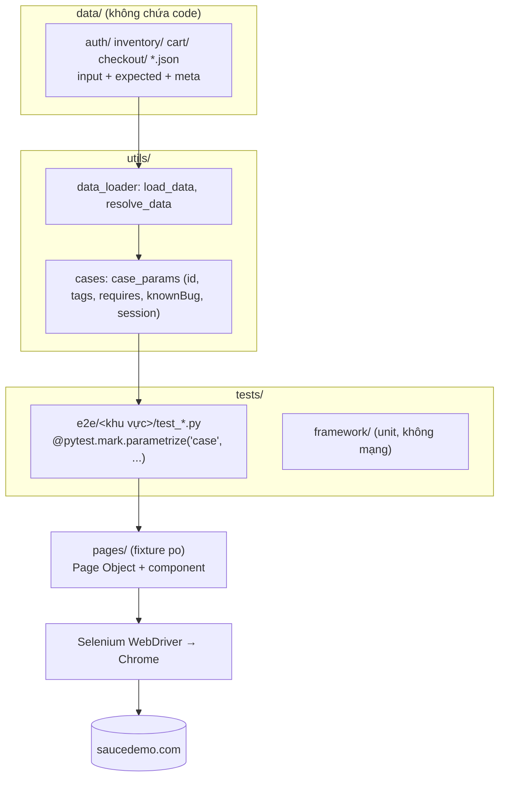

# Kiến trúc dự án saucedemo-e2e

Tài liệu mô tả **cấu trúc bên trong** của framework: các tầng, cách chúng phụ thuộc nhau, vòng đời một test
và cơ chế xử lý lỗi. Cách cài đặt, lệnh chạy và cách viết test xem [README.md](README.md).
Kết quả khảo sát trang thật (data-test, URL, thông báo nguyên văn, cookie, localStorage) xem
[docs/site-survey.md](docs/site-survey.md).

## 1. Tổng quan

- **Đối tượng kiểm thử**: https://www.saucedemo.com (Swag Labs) — SPA thuần frontend, không có backend API,
  không có trang quản trị. Phiên đăng nhập là cookie `session-username` (hết hạn sau 600 s);
  giỏ hàng là localStorage `cart-contents` (mảng id sản phẩm).
- **Công nghệ**: Python 3.11+, **Selenium WebDriver 4** (Google Chrome, Selenium Manager tự tải chromedriver),
  pytest, pytest-xdist (song song), pytest-rerunfailures (retry trên CI), allure-pytest.
- **Mô hình**: **Data-Driven** + **Page Object Model**. Dữ liệu (input + expected) nằm trong file JSON;
  mỗi phần tử dữ liệu là một test case; code test chỉ mô tả luồng và so sánh với dữ liệu.



## 2. Các tầng và trách nhiệm

| Tầng | Thư mục | Trách nhiệm | Được gọi bởi |
|---|---|---|---|
| Cấu hình | [config.py](config.py) | Đọc `.env`; URL, mật khẩu chung, danh sách user, timeout, kích thước cửa sổ | Mọi tầng |
| Data | [data/](data/) | Test case: id, tiêu đề, input, expected, meta (tags, requires, knownBug, session) | `utils/` (loader) |
| Test | [tests/](tests/) | Nạp dữ liệu, tham số hoá, gọi Page Object, `assert` kết quả so với dữ liệu | pytest |
| Page Object | [pages/](pages/) | Locator + thao tác + đọc trạng thái trang; chờ tường minh; mỗi thao tác nghiệp vụ = 1 Allure step | Test (và conftest khi tạo phiên) |
| Utils | [utils/](utils/) | Logging, phân loại lỗi, evidence, đọc dữ liệu, storage, thông báo nguyên văn | Mọi tầng |

**Quy tắc phụ thuộc** (chỉ đi một chiều): `tests → pages → Selenium`.
Page Object không chứa expected của ca kiểm thử; test không chứa locator; **locator chỉ nằm trong `pages/`**.

## 3. Chi tiết từng tầng

### 3.1 Page Object — `pages/`

```text
pages/
  base_page.py              # BasePage: find/click/type/text/wait_until/open/reload + by_test, slug, @step
  page_objects.py           # PageObjects: gom mọi page/component của 1 driver (po.inventory, po.menu...)
  components/header.py      # icon giỏ + badge
  components/burger_menu.py # nút mở/đóng, 5 mục menu, trạng thái mở
  login_page.py  inventory_page.py  product_detail_page.py  cart_page.py
  checkout_info_page.py  checkout_overview_page.py  checkout_complete_page.py
```

- Locator là tuple `(By, value)` khai báo ở đầu lớp. Ưu tiên `by_test("x")` = `[data-test="x"]`;
  ngoại lệ duy nhất: 2 nút burger dùng `By.ID` (không có `data-test` trên `<button>`), khung menu dùng `.bm-menu-wrap`.
- **Chờ tường minh**: mọi thao tác đi qua `WebDriverWait` (`find` chờ hiển thị, `click` chờ click được và
  thử lại khi bị phần tử khác che). Không dùng implicit wait, không `time.sleep` cứng.
- Mỗi trang có `landmark` (phần tử báo trang đã sẵn sàng); `open()`, `reload()` và các thao tác chuyển trang
  chờ landmark của trang đích rồi trả về Page Object của trang đó (vd `cart.checkout()` → `CheckoutInfoPage`).
- `data-test` trùng giữa các item (`inventory-item-name`...) → tìm thẻ cha có tên đúng nguyên văn rồi tìm con;
  nút thêm/bỏ dùng `data-test` có slug: `add-to-cart-<slug>` / `remove-<slug>`.
- Menu đóng có thuộc tính `hidden`; khi mở, khung trượt vào trong 0,5 s → `open_menu` chờ `aria-hidden="false"`
  và khung nằm hẳn trong màn hình trước khi bấm mục.
- Decorator `@step('... "{name}"')` (trong `base_page.py`): tạo Allure step với tên lấy từ tham số,
  che mật khẩu (`mask_secrets`), log START/PASS/FAIL kèm error category.

### 3.2 Data — `data/` và `utils/`

Đường đi của dữ liệu: `data/<khu-vực>/*.json` → `load_data` → `case_params` → `@pytest.mark.parametrize("case", ...)`
→ mỗi phần tử là một pytest item có id riêng (`AUTH-E04`, `CHK-01`...).

| Cú pháp trong dữ liệu | Thời điểm | Xử lý ở |
|---|---|---|
| `load_data("auth/login.json#invalid")` | Collection — lỗi file/nhánh báo trước khi mở browser | `utils/data_loader.py` |
| `${msg.login.lockedOut}`, `${env.password}`, `${uid}` | Runtime | `utils/data_loader.resolve_data` + fixture `ctx` |
| `"@data:inventory/sorting.json#za.names"` | Khi thay biến | `utils/data_loader.py` |

Thông báo mong đợi lấy **nguyên văn** từ trang thật, đặt tại [utils/messages.py](utils/messages.py);
dữ liệu tham chiếu bằng `${msg...}` nên không lặp chuỗi.

Metadata của case ([utils/cases.py](utils/cases.py)):

| Meta | Tác dụng |
|---|---|
| `id`, `title` | id pytest item (chọn bằng `-k`), tiêu đề Allure `[ID] Tiêu đề`; id trùng → lỗi lúc collection |
| `tags` | marker, vd `@smoke` → `pytest.mark.smoke` |
| `requires` | skip khi thiếu điều kiện (`password` = cần `SAUCE_PASSWORD`) |
| `knownBug` | `xfail(strict=True)` — lỗi cố ý của problem_user / error_user / visual_user; nếu PASS → báo "bug đã sửa?" |
| `session` | marker `role(user)` → test chạy với phiên đăng nhập sẵn của user đó |

### 3.3 Utils — `utils/`

| File | Vai trò |
|---|---|
| `logging_config.py` | Log có cấu trúc `TC_ID \| Step \| Action \| Target \| Result`; `current_tc_id` (contextvar) |
| `error_classifier.py` | Taxonomy lỗi Selenium dùng chung cho log / JUnit / Allure |
| `artifact_manager.py` | Thư mục evidence theo `run_id`, tên file an toàn |
| `data_loader.py`, `cases.py` | Nạp JSON, thay biến, che bí mật, metadata case |
| `storage.py` | Hạn cookie phiên, đọc giỏ trong localStorage (`execute_script`) |
| `assertions.py` | `poll_until` (chờ điều kiện không gắn phần tử), `money` (Decimal) |
| `routes.py`, `messages.py` | Đường dẫn trang, thông báo nguyên văn của app |

## 4. Vòng đời một lần chạy — `tests/conftest.py`

```mermaid
sequenceDiagram
    participant P as pytest
    participant C as conftest
    participant F as fixture
    participant T as test
    P->>C: pytest_configure
    Note over C: run_id, thư mục artifacts/<env>/, logging,<br/>JUnit + Allure, reruns (CI)
    P->>C: pytest_collection_modifyitems
    Note over C: gắn marker core / e2e theo thư mục
    P->>F: mỗi test: driver → po / ctx
    Note over F: marker role(user) → auth_sessions(user):<br/>cookie còn ≥ 180 s thì dùng lại, không thì đăng nhập qua UI;<br/>gắn cookie vào Chrome mới của test
    F->>T: chạy test
    T-->>C: pytest_runtest_makereport (khi FAIL)
    Note over C: error category, screenshot, page source, URL → artifacts + Allure
    F->>F: driver.quit()
```

Fixture chính:

| Fixture | Scope | Nội dung |
|---|---|---|
| `auth_sessions` | session | Hàm `user → cookie phiên còn hạn`; đăng nhập qua UI một lần cho mỗi user cần dùng (mỗi worker), tự làm mới khi cookie sắp hết hạn |
| `driver` | test | Chrome mới (headless, trừ khi `--headed`), cửa sổ 1280×720, tắt trình quản lý mật khẩu; marker `role` gắn cookie phiên |
| `po` | test | `PageObjects(driver)` |
| `ctx` | test | Biến runtime cho `${...}`: `env` (URL, mật khẩu), `msg` (thông báo) |

Mỗi test một Chrome riêng → không rò trạng thái (cookie, localStorage) giữa các test.

## 5. Lỗi và bằng chứng

- Page Object không nuốt lỗi để trả boolean; lỗi luôn đi lên tới pytest.
- Phân loại: `ASSERTION_FAILED`, `TIMEOUT`, `ELEMENT_NOT_FOUND`, `STALE_ELEMENT`, `ELEMENT_NOT_INTERACTABLE`,
  `UNEXPECTED_ALERT`, `NETWORK_ERROR`, `BROWSER_CLOSED`, `WEBDRIVER_ERROR`, `DATA_OR_CONTRACT_ERROR`, `UNEXPECTED_ERROR`.
- Một đầu mối thu evidence duy nhất (`pytest_runtest_makereport`, chạy trước khi đóng driver):
  screenshot, page source, URL hiện tại.
- Bí mật: mật khẩu chỉ ở `.env` / GitHub Secret `SAUCE_PASSWORD`; `mask_secrets` che trong log và tên step.
- Đầu ra:

```text
artifacts/prod/
  logs/  screenshots/<run_id>/  page_sources/<run_id>/  junit/results.xml  allure-results/
```

## 6. Phân nhóm test

| Thư mục | Marker | Cần mạng? |
|---|---|---|
| `tests/framework/` | `core` | Không — unit test của chính framework |
| `tests/e2e/<khu-vực>/` | `e2e` | Có — smoke, auth, inventory, cart, checkout, menu |

Marker theo dữ liệu: `smoke` (từ `tags`).

## 7. CI/CD và tài liệu sinh tự động

- [.github/workflows/e2e.yml](.github/workflows/e2e.yml): chạy khi push/PR vào `main` hoặc chạy tay theo marker.
  Các bước: cài dependency (Chrome có sẵn trên runner) → `--collect-only` (bắt lỗi dữ liệu sớm) → `pytest -n 4`
  → bảng tóm tắt từ JUnit → upload `artifacts/prod/`.
- `scripts/gen_test_cases.py` → [TEST_CASES.md](TEST_CASES.md) (từ kết quả lần chạy gần nhất).

## 8. Mở rộng framework

| Muốn | Sửa ở đâu |
|---|---|
| Thêm case cho test có sẵn | Thêm phần tử vào file JSON trong `data/` — không sửa code |
| Luồng kiểm thử mới | Dữ liệu trong `data/`, hàm test mới trong `tests/e2e/<khu-vực>/` dùng `case_params` |
| Thao tác / phần tử mới | Locator + method trong `pages/` (bọc `@step` nếu là bước nghiệp vụ) |
| Trang mới | Lớp con `BasePage` trong `pages/` (có `path`, `landmark`), thêm vào `PageObjects` |
| Thông báo mới của app | `utils/messages.py`, dữ liệu dùng `${msg...}` |
